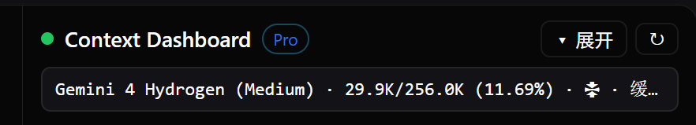
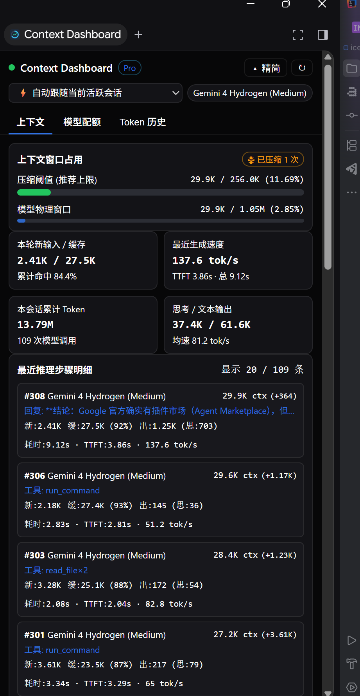
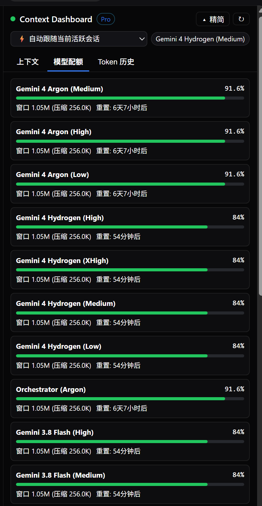
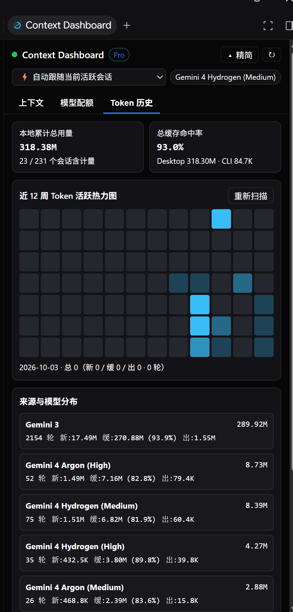

# Antigravity Context Dashboard

一个**官方插件机制、纯只读、零第三方依赖**的 Google Antigravity Sidecar 监控插件，用于在右侧辅助栏实时查看当前会话的上下文窗口占用、压缩次数、生成速度（TTFT / tok/s）、模型配额以及本地历史 Token 用量热力图。

> **安全声明**：本插件完全遵循 Antigravity 官方 `plugin` + `sidecar` 规范，**不修改 `app.asar` 或任何客户端二进制文件**，所有数据均在本地通过只读 RPC 与本地会话记录读取，不会上传任何数据到外部服务器。

---

## 核心功能

- **上下文监控（Context）**
  - **双上限进度条**：同时展示「压缩阈值（推荐上限）」与「模型物理窗口」，直观掌握何时接近自动压缩。
  - **压缩次数检测**：自动识别会话历史中的上下文压缩事件并标注次数。
  - **生成性能指标**：展示最近一次模型调用的 **TTFT（首字延迟）**、总耗时、生成速度（`tok/s`）以及本轮新输入 / 缓存命中率。
  - **推理步骤明细与分页**：按倒序展示最近推理步骤（工具调用 / 回复摘要、Token 增量 `+delta`、单步耗时与速率），默认加载最近 20 条，支持点击加载更多 / 收起。
- **模型配额（Quotas）**
  - 实时读取当前账号下各可用模型的剩余配额百分比、窗口上限、压缩阈值及配额重置倒计时。
- **Token 历史（History）**
  - 扫描本机 Antigravity Desktop 与 CLI 的历史会话记录，统计累计总用量、总缓存命中率、近 12 周活跃热力图以及各模型/来源分布。
- **跨会话自动跟随 & 一行精简模式**
  - 支持「⚡ 自动跟随当前活跃会话」，切换或新建对话时面板自动同步到正在进行的会话。
  - 支持「精简 / 展开」折叠切换，平时可只保留一行核心状态条，减少对编辑区宽度的占用。
- **深浅色主题自适应**
  - 自动跟随 Antigravity 宿主主题（深色 / 浅色模式切换）。

---

## 效果展示

### 1. 一行精简模式（折叠状态）
平时收起后仅占一行，显示当前模型、上下文占用百分比与压缩/缓存摘要，点击 `▾ 展开` 即可查看完整面板：



### 2. 上下文监控面板
展示双上限进度条、压缩次数、本轮新输入/缓存命中率、TTFT 与 `tok/s` 速率，以及最近推理步骤明细：



### 3. 模型配额面板
查看当前账号下各模型的剩余配额比例与重置倒计时：



### 4. Token 历史热力图
汇总本地 Desktop 与 CLI 历史会话 Token 消耗、近 12 周活跃热力图及模型分布：



---

## 安装方式

本仓库根目录即为一个完整的标准 Antigravity 插件目录，无需编译或安装额外 npm 依赖，直接克隆到本机全局插件目录即可。

### 方法一：Git 一键克隆安装（推荐）

**Windows (PowerShell)：**
```powershell
git clone https://github.com/hardill/antigravity-context-dashboard.git "$env:USERPROFILE\.gemini\config\plugins\context-dashboard"
```

**macOS / Linux：**
```bash
git clone https://github.com/hardill/antigravity-context-dashboard.git ~/.gemini/config/plugins/context-dashboard
```

### 方法二：下载 ZIP 手动安装

1. 点击 GitHub 页面右上角 **Code -> Download ZIP** 下载源码压缩包。
2. 解压后，将文件夹重命名为 `context-dashboard`，放入全局插件目录：
   - **Windows**：`%USERPROFILE%\.gemini\config\plugins\context-dashboard`
   - **macOS / Linux**：`~/.gemini/config/plugins/context-dashboard`

---

## 使用说明

1. **打开面板**：安装完成后，Antigravity 会自动发现并启用插件。可在右侧辅助栏打开 **Context Dashboard**，或在对话中让 Agent 打开 Context Dashboard 面板。
2. **切换会话**：下拉框默认选中 `⚡ 自动跟随当前活跃会话`，也可以手动选择任意历史会话查看。
3. **精简 / 展开**：点击右上角 `▴ 精简` / `▾ 展开` 按钮切换单行状态条与完整仪表盘（状态会保存在本地）。
4. **管理插件**：可在 Antigravity 的 Customizations / Plugins 页面随时启用、禁用或卸载 `context-dashboard`。

### 更新与卸载

- **更新**：在插件目录执行 `git pull`，然后在面板点击刷新按钮（或禁用再重新启用插件使后台 Sidecar 进程重载）。
- **卸载**：在 Customizations 页面点击卸载，或直接删除 `~/.gemini/config/plugins/context-dashboard` 目录。

---

## 目录结构

```text
antigravity-context-dashboard/
├── plugin.json                          # 插件清单与 sidecar 入口声明
├── assets/
│   └── logo.svg                         # 插件图标
├── skills/
│   └── context-dashboard/
│       └── SKILL.md                     # Agent 调用与面板导航指引
├── sidecars/
│   └── context_board/
│       ├── sidecar.json                 # Sidecar 运行配置 (SIDECAR_UI_ENTRYPOINT_AUX_PANE)
│       ├── package.json
│       ├── main.mjs                     # Sidecar HTTP 服务与 API 路由
│       ├── index.html                   # 面板页面结构
│       ├── styles.css                   # 自适应深浅色主题样式
│       ├── app.js                       # 前端交互、分页与自动轮询逻辑
│       └── lib/
│           ├── ls-client.mjs            # 只读 Language Server RPC 客户端
│           └── history-scanner.mjs      # 本地 Desktop + CLI 会话历史扫描器
└── docs/
    └── images/                          # README 展示截图
```
